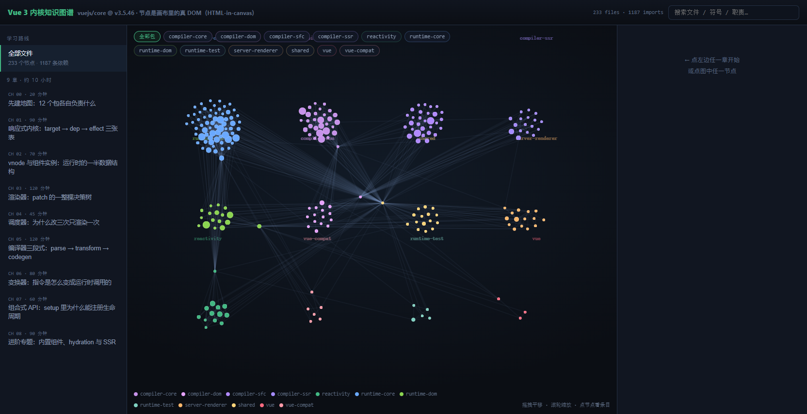
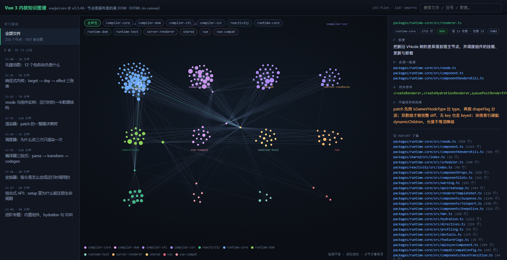
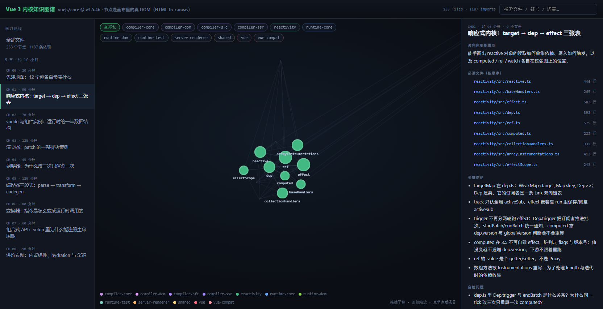
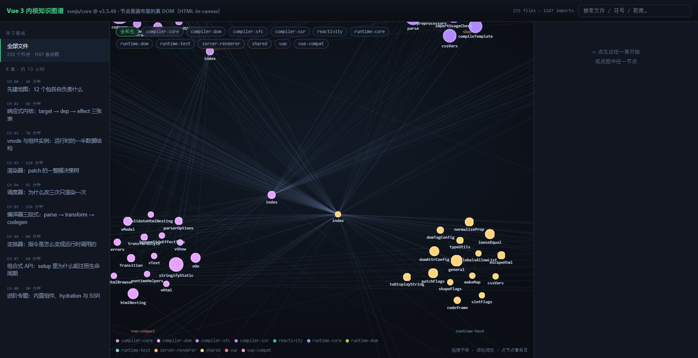

# Vue 3 内核知识图谱

把 vuejs/core 的 233 个源文件、1187 条依赖关系和 234 条「这个文件在干嘛、改它要小心什么」的认知条目，
做成一张可以点着学的地图，外加一条 9 章的学习路线。

打开 **[在线版](https://raywh.github.io/vue3-internals-atlas/)**（单文件、离线、无外链、无依赖）。

> ⚠️ 在仓库里点 `vue-graph.html` 看到的是源码，不是页面。GitHub 不会执行仓库里的 HTML（否则任何仓库都能在 github.com 域名下跑 JS，等于开放 XSS），只当文本给你看；渲染版只能走 GitHub Pages。想离线看就 `git clone` 后双击该文件。

### 渲染方式：HTML-in-canvas

这个版本不用 `arc()` 画节点，而是把 233 个节点做成 `<canvas content="drawable">` 里的**真 DOM**：
圆点是一个 `drawable` 的 `<div>`，标签是另一层 `drawable`（固定 10px，不随缩放放大），每帧用
`drawElementImage` 把它们的快照画到当前变换的位置；边仍旧是 canvas 2D。

因此**需要 Chrome / Edge 157+**。不支持时页面顶部会给一条横幅，并提供
[`vue-graph-classic.html`](vue-graph-classic.html)——同数据、纯 Canvas2D、任何浏览器都能开。

在 Chrome 157.0.8103.79 / headless 下实测（不是估计）：

| 项 | 结果 |
|---|---|
| 整帧成本（233 圆点 + 233 标签 + 1187 边） | **1.6–1.7 ms**（60fps 预算 16.7 ms） |
| `drawElementImage` 失败次数 | 0 |
| 放大 2×/3× 的文字 | **重新栅格，不糊** |
| 缩放来回（1×→3×→1×） | 与新元素逐像素一致，不累积失真 |
| dest rect 的副作用 | **会改元素几何**：画到 (500,300)，`getBoundingClientRect` 就是 (500,300) |
| 初始布局在画布外 | 没有 paint record，调用抛 `No cached paint record` |

所以命中测试不依赖元素几何（那只是「上次画到哪」），而是按自己的变换算；元素全部 `pointer-events:none`。



## 这是什么

一张图谱，三种看法：

- **按包看**：左侧色块按 package 聚簇，点任一节点看它的条目
- **按章看**：左栏 9 章学习路线，点一章只亮这一章的文件，右栏给「读完能做到什么 / 必读文件顺序 / 关键结论 / 自检问题 / 动手」
- **按需查**：右上角搜索文件、导出符号或职责关键词

每条节点带着一行 [AOCI-CODE](https://github.com/aoci-spec/aoci-code) 的 FRAS 条目：

```
renderer.ts[DB9L]: F:把新旧 VNode 树的差异落到宿主节点，并调度组件的挂载、更新与卸载
  | R:code:packages/runtime-core/src/vnode.ts, ...     ← 改它时必须一起读的文件
  | A:createRenderer,createHydrationRenderer,...        ← 对外符号
  | S:patch 先用 isSameVNodeType 比 type，再按 shapeFlag 分派；双数组才做完整 diff ...
```

- **F** 职责 · **R** 强关联 · **A** 对外契约 · **S** 不能改坏的约束（代码里推不出来、只有读了才知道的那些）



## 数据

| 项 | 值 |
|---|---|
| 源码 | [vuejs/core](https://github.com/vuejs/core) `7de9e41` = v3.5.46（2026-11-20） |
| 规模 | 234 个源文件 / 57,583 行（不含测试与 `.d.ts`） |
| 图谱 | 233 节点 / 1187 条 import 边（差 1 个是 `.d.ts`，依赖图解析主动跳过） |
| 索引 | 234 条 Entry、30,122 tokens、压缩比 **19.1 : 1** |
| 治理 | `aoci verify` 已对齐；`aoci check` 五净；C7+ 条目 S 覆盖 97/97 |

## 9 章路线（约 10 小时）

| 章 | 主题 | 时长 |
|---|---|---|
| CH0 | 先建地图：12 个包各自负责什么 | 20 min |
| CH1 | 响应式内核：target → dep → effect 三张表 | 90 min |
| CH2 | vnode 与组件实例：运行时的一半数据结构 | 70 min |
| CH3 | 渲染器：patch 的一整棵决策树 | 120 min |
| CH4 | 调度器：为什么改三次只渲染一次 | 45 min |
| CH5 | 编译器三段式：parse → transform → codegen | 120 min |
| CH6 | 变换器：指令是怎么变成运行时调用的 | 80 min |
| CH7 | 组合式 API：setup 里为什么能注册生命周期 | 60 min |
| CH8 | 进阶：内置组件、hydration 与 SSR | 90 min |





## 索引是怎么来的

索引不是脚本生成的摘要，是**模型逐文件读源码之后写的**——这是 AOCI-CODE 的合同：Host 模型创作语义，工具只负责校验、绑定、原子写入。

流程：`aoci init` 收窄范围到 `packages/*/src` → `aoci scan` 建基线 → `aoci_maintain` 领批次（每批约 29 个文件）→ 读这批源码写 FRAS → `aoci_update_entry` 整批提交 → 下一批。共 9 批，被它按硬上限（C 档的 R/S token 预算、字段结构）退回过 6 次，逐条按 `safe_repair_action` 修完。

`entries/` 里留着每批的原始产出，`index/` 里是最终写入的索引（`aoci.code.txt`）。

## 自己复现 / 换别的仓库

```bash
git clone --depth 1 https://github.com/vuejs/core.git vue-core
# 装上 AOCI-CODE 的 prebuilt 二进制（v0.2.0-rc3），核对 SHA256SUMS
aoci --repo vue-core init --locale zh-CN
aoci --repo vue-core scope rule add tests --action exclude --pattern '**/__tests__/**' --order 10 --reason '学习用途'
aoci --repo vue-core scope activate --json && aoci --repo vue-core scan

export AOCI_BIN=/path/to/aoci
node scripts/aoci-mcp.mjs call aoci_maintain   # 领批次
node scripts/parse-batch.mjs                   # 候选清单
node scripts/merge-validate.mjs entries/*.json # 本地预校验
node scripts/aoci-mcp.mjs call aoci_update_entry submit.json

node scripts/build-graph.mjs && node scripts/build-html.mjs && node scripts/check-build.mjs
```

## 三个边界

1. **边是 import，不是调用图。** `activeSub`、`targetMap` 这种运行时全局连接不会出现在边上，它们在 S 字段里。
2. **条目质量取决于读得够不够细。** 每条 S 都能回到源码核对；抽查过 14 条，13 条相符，1 条说反了（`renderer.ts` 的 S 首句），已按证据改掉。
3. **AOCI-CODE 是 v0.2.0-rc3。** 索引格式（Volumes v1）和 CLI 都还在变。

## 许可

本仓库自己的脚本、文档、图谱数据用 MIT（见 `LICENSE`）。
被索引的源码属于 [vuejs/core](https://github.com/vuejs/core)（MIT，© Evan You and Vue contributors）；**本仓库不重新分发 Vue 源码**，只保存文件名、符号名与派生的一行描述。检索这些描述时仍以你本地的 vue 版本为准。
